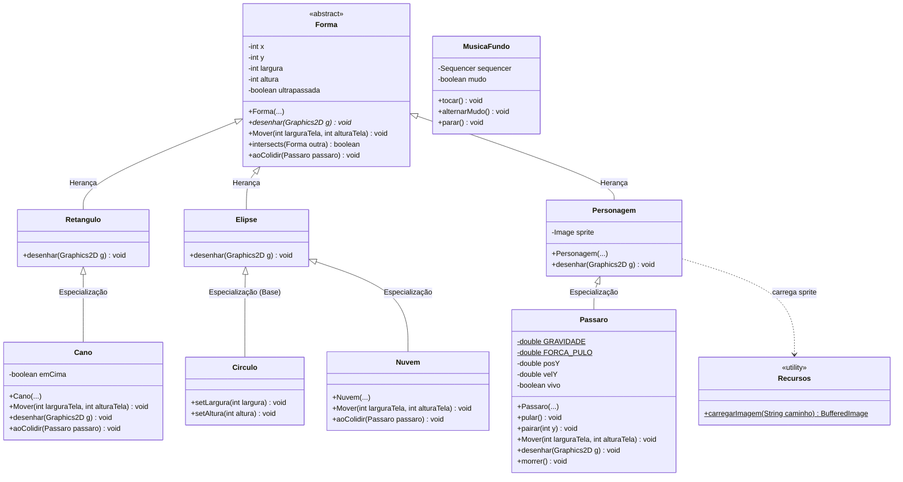

# Flappy Bird POO - Mini Projeto 04

Projeto desenvolvido para a disciplina de Programação Orientada a Objetos, utilizando Java e Swing, sob a orientação do Prof. Caina Antunes. Transformamos a base de um "ScreenSaver" em um jogo completo estilo Flappy Bird, aplicando rigorosamente os quatro pilares da POO.

**Desenvolvido por:** Lívia e Danilo

---

## 🎮 Controles

| Tecla | Ação |
| :--- | :--- |
| `ESPAÇO`, `↑`, `W` ou clique do mouse | Começar / pular / reiniciar após o Game Over |
| `M` | Liga ou desliga a música de fundo |

## 🎵 Música de Fundo e Física

- **Música:** a classe `audio.MusicaFundo` gera uma melodia em MIDI (melodia, baixo e bateria) usando o sintetizador embutido do Java (`javax.sound.midi`), tocando em loop contínuo. Não é necessário nenhum arquivo de áudio.
- **Gravidade leve:** o `Passaro` usa física em `double` (gravidade `0.4`, pulo `-7.0` e velocidade máxima de queda `8`), deixando o voo mais suave. Os valores podem ser ajustados nas constantes do topo da classe.
- **Visual:** canos com "boca" na abertura, volume em degradê e sombra; nuvens fofas feitas de várias elipses; céu com sol, morros em parallax e chão com grama animada; placar centralizado com contorno e painel de Game Over com pontos, recorde e aviso de novo recorde.
- **Imagens:** a classe `util.Recursos` carrega as imagens pelo classpath (`bin/`) e, se não encontrar, pelas pastas `src/` ou `04_ScreenSaverJava/src/`, funcionando independente da pasta de onde o jogo é executado.

---

## 🏗️ Os 4 Pilares da POO no Projeto

| Pilar | Onde está no código? | Como foi aplicado? |
| :--- | :--- | :--- |
| **Abstração** | Classe `model.Forma` | Criamos uma classe abstrata genérica que define os atributos e métodos base (x, y, `Mover`, `desenhar`) para tudo o que aparece na tela, sem se preocupar com os detalhes de desenho de cada forma específica. |
| **Encapsulamento** | Todas as classes do `model` | Todos os atributos (`x`, `y`, `velocidade`, `vivo`) são `private`. O acesso é feito via Getters e Setters, permitindo validações (ex: impedir largura negativa) e protegendo a física do jogo de alterações indevidas. |
| **Herança** | `Passaro`, `Cano`, `Nuvem` | `Passaro` estende `Personagem`, herdando a capacidade de desenhar sprites. `Cano` estende `Retangulo`. Evitamos repetição de código reutilizando a estrutura visual já existente e adicionando apenas comportamentos novos (como a gravidade). |
| **Polimorfismo** | `ScreenSaver.java` e `aoColidir()` | No Game Loop, usamos listas `List<Forma>` genéricas: `formas` (pássaro e canos) e `nuvens` (fundo, separada para não contar pontos). Chamamos `Mover()` e `desenhar()` sem precisar saber o tipo de cada objeto. O método `aoColidir()` é reescrito (`@Override`): o `Cano` causa Game Over e a `Nuvem` sobrescreve sem efeito, pois fica fora do teste de colisão. |

---

## 📊 Diagrama de Classes (Mermaid)

> **Observação:** A classe `Circulo` vem da base feita em aula (o protetor de tela) e foi mantida na hierarquia, mas não é usada no jogo. As classes `Nuvem`, `Cano` e `Passaro` são as que dão vida ao Flappy Bird.